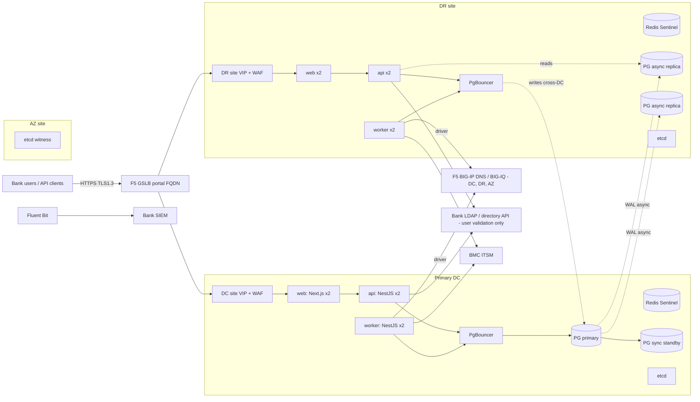
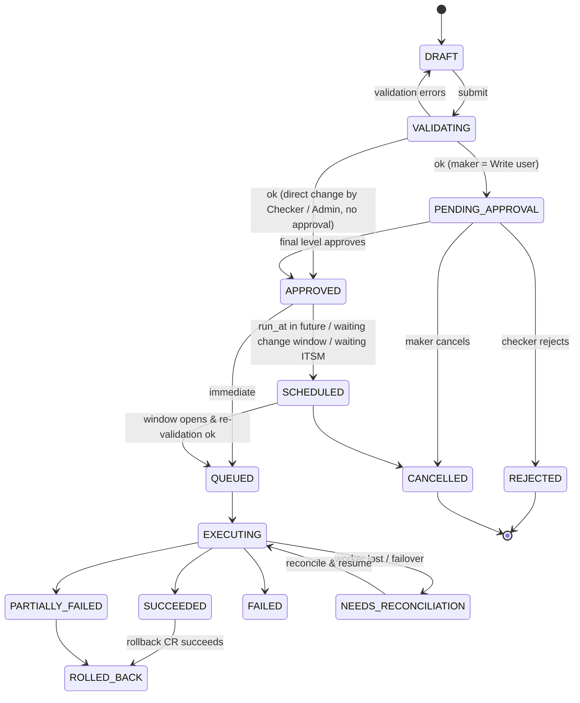
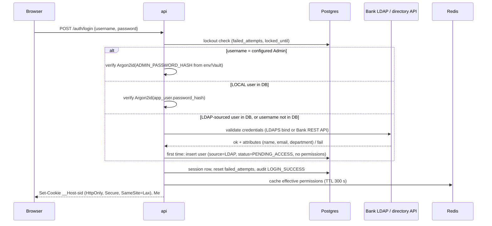
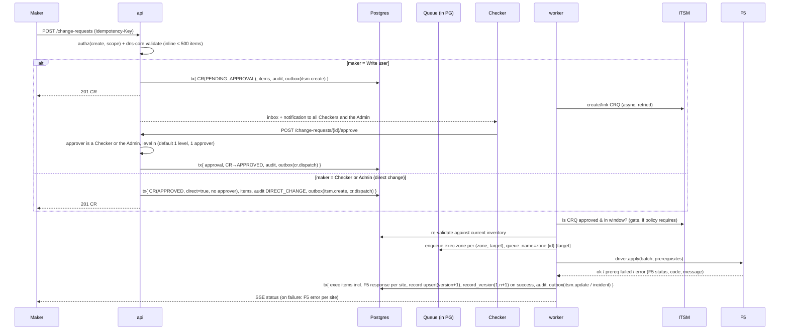

# 01 · Low-Level Design: SBI F5 DNS Management Portal

Version 3.2 (supersedes the architecture in Proposal v2.0). Read [00-context.md](00-context.md) first.

> **v3.2 changes (04-Nov-2026), aligned with Proposal v2.2:** Read = all groups (no group assignment); Write = Admin-assigned groups only, CRs need approval; Checker = always Read + Write on **all** groups, approves Write CRs and makes **direct changes without approval**; the Admin's own changes and rollbacks are direct too. Write CRs go to all Checkers + the Admin. F5 errors are stored per site and shown on the request. Affected sections: §3.2, §4.1, §4.2, §4.4, §5.2, §5.4, §5.5, §8, §14, §15.
>
> **v3.1 changes (04-Nov-2026), aligned with Proposal v2.1:** login is the portal's own (local DB first, then the Bank LDAP/directory API). There is **no SSO/IdP, no AD group sync and no MFA**. A single Admin is defined in protected config. Access is **Read / Write / Checker per DNS group**, and Checker can also be scoped to All groups. Every record is **versioned (1.0, 1.1, …)**, and the Admin can compare versions and roll back immediately or on a schedule. Affected sections: §1, §3, §4.4, §5.1, §5.2, §5.5, §8, §9.2, §10, §12.3, §13, §14, §15.
>
> **Open:** the proposal names Java/Spring Boot + React, while this LLD uses NestJS + Next.js. The stack must be decided before S0. The domain design below is stack-neutral.

---

## 1. Architecture



**Principles**
1. **Single durable store.** All state lives in PostgreSQL, including the job queue, audit log and outbox. Redis is a cache only.
2. **Stateless tiers are active-active in both sites.** Only the DB writer is single-site, and Patroni + etcd decide which site holds it.
3. **Never call F5 synchronously from a user request.** Every F5 write goes through the durable queue → executor → driver.
4. **Serialise per zone, parallelise across zones, cap per F5 target.**
5. **Exactly-once effect.** Change items are idempotent and DNS prerequisites (or read-before-write) guard every mutation.

---

## 2. Codebase layout (pnpm + Turborepo monorepo)

```
dns-portal/
├─ apps/
│  ├─ web/                 Next.js 15 App Router (UI only, no business logic)
│  ├─ api/                 NestJS HTTP API (/api/v1), SSE, auth
│  └─ worker/              NestJS standalone: executor, sync, scheduler, integrations, outbox relay
├─ packages/
│  ├─ contracts/           zod schemas + generated OpenAPI types (shared by web/api)
│  ├─ dns-core/            RR types, parsers, validators, CNAME graph, diff engine (pure TS, 100% unit tested)
│  ├─ db/                  Drizzle schema, SQL migrations, repositories
│  ├─ f5-driver/           F5Driver port + adapters: icontrol-rest, bigiq, rfc2136
│  ├─ itsm-driver/         ItsmDriver port + BMC Helix adapter + mock
│  ├─ authz/               permission evaluator (pure) + cache wrapper
│  ├─ queue/               JobQueue port + Graphile Worker adapter
│  └─ observability/       pino logger, OTel setup, metrics
├─ deploy/                 Containerfiles, compose (dev), OpenShift/Helm, Patroni, PgBouncer, Fluent Bit
├─ tests/                  e2e (Playwright), contract (Pact/Schemathesis), perf (k6), chaos
└─ docs/
```

Rules: `dns-core` and `authz` have no I/O. Every external system sits behind a **port** with a mock adapter, so CI never needs F5, LDAP or ITSM. Add `packages/ldap-client/` (`DirectoryPort` with LDAPS-bind and REST adapters, plus a mock).

---

## 3. Components

### 3.1 web (Next.js)
- Server Components for list and detail pages. Data is fetched server-side from `api` with the user's session cookie, so the browser never holds F5 or ITSM data it is not entitled to.
- Client components: record editor (live validation via shared `dns-core`), bulk upload, approval inbox, dashboards (ECharts).
- Tables use virtualised grids (TanStack Table + Virtual) with cursor pagination. Nothing ever loads "all rows".
- Real-time updates over SSE (`/api/v1/events`): CR status, execution progress, drift alerts.
- Build: `output: 'standalone'`, served by Node behind the site VIP. Strict CSP with nonces, no inline eval.

### 3.2 api (NestJS)

| Module | Responsibility |
|---|---|
| `auth` | Username/password login (config Admin → local user → Bank LDAP), lockout, session issue/revoke, password change, portal API keys |
| `identity` | Users (sources CONFIG / LOCAL / LDAP), pending-access queue, enable/disable/unlock, password reset (Admin only) |
| `authz` | Access level per user: Read (all groups), Write (assigned DNS groups), Checker (Read + Write, all groups); effective-permission resolution (cached) |
| `inventory` | Zones, records, search, export, record versions (history, compare, live diff) |
| `grouping` | DNS groups; one owning group per record; Admin reassigns ownership |
| `change` | Change requests and items, validation, submit/cancel, direct changes (Checker/Admin), version rollback (Admin), per-site F5 result and error |
| `approval` | Routing of Write users' CRs to all Checkers + Admin, approval inbox, optional multi-level per group |
| `schedule` | Change windows, freeze calendar, run-at |
| `report` | Dashboards, KPI queries, CSV/XLSX export (async for large exports) |
| `audit` | Audit query/export; audit writer used by all modules |
| `admin` | F5 targets, zone↔target mapping, system settings, integration health |
| `events` | SSE fan-out (Redis pub/sub per site, fed by PG `LISTEN/NOTIFY`) |

Cross-cutting concerns are implemented as Nest guards/interceptors: `AuthGuard` → `PermissionGuard(permission, scopeResolver)` → `IdempotencyInterceptor` → `AuditInterceptor` → zod validation pipe → handler.

### 3.3 worker (NestJS standalone, same image, different entrypoint)

| Task (queue) | Trigger | Concurrency |
|---|---|---|
| `cr.validate` | CR submitted (bulk only; small CRs validate inline) | 8 |
| `cr.dispatch` | CR approved, or run-at reached | 4 |
| `exec.zone` | One job per (zone, target) batch, **serial per zone via `queue_name`** | global 64, per target capped |
| `exec.finalize` | All targets of a CR are done | 8 |
| `sync.poll` | Cron every 60 s: SOA serial per zone/target | 16 |
| `sync.zone` | Serial changed or forced: IXFR/AXFR → diff → upsert | 8, serial per zone |
| `itsm.*` | Outbox events (create CRQ, update, incident) | 8 |
| `siem.ship` | Audit outbox → syslog/CEF (Fluent Bit also tails app logs) | 2 |
| `report.refresh` | Every 5 min: refresh materialised counts | 1 |
| `housekeeping` | Hourly: expire idempotency keys, create partitions, prune jobs | 1 |

Graphile Worker uses `SKIP LOCKED` plus `LISTEN/NOTIFY`, so pickup latency is under 10 ms. Workers in **both** sites pull from the same queue on the current primary. No leader election is needed.

---

## 4. Domain model and state machines

Full DDL: [02-data-model.sql](02-data-model.sql).

### 4.1 Change Request (CR)

A CR holds 1..N **change items**. Each item is one RR operation: `CREATE | UPDATE | DELETE` with `before` and `after` images.



Transitions run inside **one DB transaction** that does three things: updates `change_request.status` with a version check, inserts an `audit_event`, and inserts any `outbox` rows (job enqueue, ITSM, notification). Illegal transitions throw `409 INVALID_STATE`.

### 4.2 Execution (per CR × target)
`PENDING → RUNNING → (SUCCEEDED | FAILED | CONFLICT)`. Each item × target gets a row in `change_execution_item` with `attempt`, `driver_request_id`, `result`, `error_code`, `duration_ms`, plus the F5 response for that site: `f5_status` (HTTP status), `f5_error_code` and `f5_error_message` exactly as returned by F5.

- **F5 error display:** every change, including rollbacks, stores the F5 result per site (DC / DR / AZ). If F5 rejects the change or it does not succeed, the CR goes to `FAILED` (or `PARTIALLY_FAILED`), and the request page shows, for each site, the F5 error code and message as returned. It is visible to the maker, the Checkers and the Admin, kept in the audit trail and sent to SIEM.

### 4.3 Record identity
- An RRset is `(zone_id, owner_name, rr_type)`. A record is an RRset plus a `rdata_hash`.
- `record.version` (bigint) changes on every observed change. The API returns it as an `ETag`, and updates require `If-Match`.
- Every record has exactly **one owning DNS group** (`record.owner_group_id`). Records with no owner yet, for example new records found by sync, are *Unassigned* and visible only to the Admin until assigned.

### 4.4 Record versions (business versioning)
Separate from the technical `record.version` ETag. `record_version` is an **append-only** history of configurations that were actually live on F5.

| Rule | Detail |
|---|---|
| Numbering | `version_no` 0, 1, 2 … shown as **1.0, 1.1, 1.2 …** (after 1.9 comes 1.10) |
| When a version is created | Only after a change has been **successfully applied** to F5 (all required sites). Pending, rejected or failed CRs create none |
| Content | Full config snapshot (zone, name, type, values/targets, TTL, related F5 object config) plus metadata: group, maker, approver (empty for direct changes), reason, ITSM ref, applied_at, per-site result |
| Delete | Creates a final version with `op = DELETE` that keeps the last config, so a deleted record can be restored |
| Rollback | Restoring version *k* commits a **new** version with `op = ROLLBACK` and *k*'s config (1.3 → restore 1.1 = new 1.4). History is never rewritten |
| Retention | Same as the audit trail (7 years); version events are also sent to SIEM |

---

## 5. Key flows

### 5.1 Login (local DB first, then Bank LDAP; no SSO, no MFA)

- **Order is fixed:** config Admin → local user → LDAP. LDAP is called only for users that are LDAP-sourced or not in the DB. Bank passwords are never stored, so LDAP users are validated against LDAP on every login.
- **Pending access:** a first-time LDAP user can sign in but sees no records (`ACCESS_PENDING` on data calls) until the Admin maps them to groups and permissions. They appear in the Admin's pending-users queue.
- **Lockout:** 5 failed attempts → locked for 15 min (both configurable to Bank IS policy). Every failure returns the same `401 INVALID_CREDENTIALS`, so usernames can't be enumerated. Locks, unlocks and failures are audited and sent to SIEM.
- **LDAP outage:** the Admin and local users can still sign in. LDAP users get `503 DEPENDENCY_UNAVAILABLE`.
- **Local users:** created by the Admin with a temporary password and `must_change_password`. The password policy (length, complexity, expiry, history) follows Bank IS policy.
- **Admin:** exactly one. Its username and Argon2id password hash come from protected config (`.env` / app config, preferably injected from Vault/KMS). The Admin is not editable through the UI or API. Rotation means a config change plus a reload, done as an audited change. A break-glass procedure is documented in the runbook.
- **Sessions:** idle timeout 15 min, absolute timeout 8 h, server-side revocation (session row in PG, cached in Redis). Disabling a user or changing their permissions revokes or refreshes their sessions.
- **API clients:** portal-issued API keys only (Argon2id hashed, IP allow-list, scoped to groups and permissions).

### 5.2 Create, approve, execute

- **One group per CR:** all items in a CR must belong to the same owning group (`MIXED_GROUPS` otherwise).
- **Routing:** CRs from Write users go to all Checkers and the Admin (Checkers cover all groups). One approval from any of them is enough. When it arrives, the CR leaves every other inbox. A rejection needs a comment.
- **Direct changes:** CRs raised by a Checker or the Admin (including Admin rollbacks) skip approval. They are validated with the same rules, then executed immediately or at `runAt`. They are audited as direct changes (no approver) and create a new record version on success.
- **Write users cannot approve** (`403 FORBIDDEN_SCOPE` on approve/reject).

### 5.3 Inventory sync and drift detection (J1.5)
1. `sync.poll` reads the SOA serial for each (zone, target) with one cheap DNS query.
2. If the serial differs from `zone_target.last_serial`, it enqueues `sync.zone` (serial per zone).
3. `sync.zone` runs **IXFR** (falls back to AXFR) over TSIG, or the driver's list API if transfers are disabled. It streams the result into a temp table with `COPY`, then **set-diffs** it in SQL against `record`.
4. Each diff row is matched against `change_execution_item` from the last N minutes. A match is an *expected* change. Anything else is **drift**: a `drift_event` is inserted, the change shows on the dashboard, and an optional ITSM incident is raised.
5. Policy per zone: `ALERT_ONLY` (default) | `ADOPT` (accept F5 as truth) | `REVERT` (raise an auto CR to restore; needs approval by a Checker or the Admin).

Full resync: nightly AXFR per zone, staggered. F5 is always the source of truth for the live state.

### 5.4 Scheduled change
`APPROVED` (or a direct Checker/Admin change) with `run_at`, or a policy that needs a change window → `SCHEDULED`. A job with `run_at` is queued. At fire time the system checks the freeze calendar, ITSM state and re-validation. A failed check moves the CR to `FAILED` with reason `PRECONDITION`, and the maker is notified.

### 5.5 Version compare and rollback (Admin only)
1. **Compare:** `GET /records/{zoneId}/{recordId}/versions/compare?from=1.1&to=1.3` gives a field-level diff (ADDED / CHANGED / REMOVED). `to=live` compares a stored version with the configuration read from F5 now, which shows out-of-band changes.
2. **Rollback:** `POST /records/{zoneId}/{recordId}/rollback {targetVersionNo, runAt?, reason, itsmRef?}` creates a CR of kind `ROLLBACK` holding the target version's snapshot. It can run immediately or on a schedule (`runAt`).
3. **Approval:** none. Like other Admin changes, the rollback is validated and then executed directly (immediately or at `runAt`).
4. **Execution:** at run time the worker re-validates, compares live F5 to the latest version and applies the snapshot across DC/DR/AZ through the normal idempotent engine. If the record changed after the rollback was scheduled, the CR is held in `SCHEDULED` for Admin confirmation instead of running.
5. **Result:** success commits a **new** version (`op = ROLLBACK`, `rolled_back_from_version_no = k`). On failure, the F5 error per site is shown and audited, as for any CR (§4.2). Scheduled rollbacks are ordinary scheduled jobs, so they survive a site failover.

---

## 6. Scale design ("lots of transactions at a time")

### 6.1 Where load actually lands

| Path | Volume | Bottleneck | Answer |
|---|---|---|---|
| Browse/search inventory | Highest (reads) | DB scans | Indexes, partitions, read replicas, Redis page cache |
| Submit CRs (UI/API/bulk) | Bursty | Validation CPU, DB writes | Inline for small CRs, async for bulk; batched inserts |
| Apply to F5 | Bounded | **F5 mgmt API** | Queue + per-zone batching + per-target token bucket |
| Sync from F5 | Periodic | Transfer size | SOA polling, IXFR, COPY + SQL diff |
| Audit/SIEM | Every write | Write amplification | Same-tx insert, monthly partitions, async ship |

### 6.2 Execution engine (the core of throughput)
- **Coalescing:** approved items are grouped by `(zone, target)`. One `exec.zone` job carries up to `BATCH_MAX` (default 200) items, which maps to one RFC 2136 UPDATE message or one iControl REST transaction.
- **Ordering:** `queue_name = zone:{zoneId}:{targetId}`, so batches for a zone on a target run strictly in order. Different zones run in parallel.
- **Per-target cap:** a token bucket per F5 target, held in PG (`f5_target.max_concurrency`, `rate_per_sec`). The executor takes a permit via `pg_try_advisory_lock(target_hash, slot)` for slot 1..N. With no permit, the job is rescheduled with jitter (50–250 ms). Living in PG, the cap holds across **both** sites.
- **Backpressure:** if the queue depth for a target exceeds the threshold, the API keeps accepting CRs (they are durable) but the UI shows an ETA. API clients get a `Retry-After` hint on `/executions`.
- **Retries:** transient errors (5xx, 503 restjavad busy, timeouts) retry with exponential backoff and jitter, max 8 attempts. Permanent errors (validation, prerequisite failure) fail fast to `CONFLICT`/`FAILED`.
- **Circuit breaker** per target: open after 5 consecutive failures for 30 s. Integration health shows on the admin dashboard.
- **Fan-out (D2):** `zone_target.mode = SYNC_GROUP` writes to one designated target, and the sync group propagates. `mode = EACH` writes to every target; the CR is `SUCCEEDED` only when all targets succeed, otherwise `PARTIALLY_FAILED` with per-target detail.

### 6.3 Idempotency and exactly-once effect
- **API:** `Idempotency-Key` header on all POSTs. The key, request hash and response are stored for 24 h (`idempotency_key` table, hot copy in Redis). A replay returns the stored response; same key with a different body → `422`.
- **Executor:** before calling F5, the system writes `change_execution_item(status=RUNNING, attempt++)`. The F5 call itself is guarded:
  - RFC 2136: **prerequisites** (RRset exists with the `before` value / does not exist) make a replay harmless. A second apply fails the prerequisite, and the item is then marked `SUCCEEDED` if the current state already equals `after`.
  - REST/BIG-IQ: **read-compare-write**. Read the current RR; if it equals `after`, mark done; if it equals `before`, write; anything else is `CONFLICT`.
- **After a failover** (`NEEDS_RECONCILIATION`): the executor runs the same read-compare logic, so no change is applied twice.

### 6.4 Caching (Redis, per site)

| Key | Content | TTL | Invalidation |
|---|---|---|---|
| `perm:{userId}` | Effective access (READ or CHECK = all groups; WRITE × assigned groups) | 300 s | `NOTIFY authz_changed` on grant, user status or record-ownership change |
| `sess:{sid}` | Session (mirror of PG row) | Idle 15 min | Logout/revoke → delete + NOTIFY |
| `zone:list:{scopeHash}` | Zones visible to scope | 60 s | NOTIFY on zone change |
| `rec:page:{zone}:{filterHash}:{cursor}` | First 3 pages of common lists | 30 s | NOTIFY `record_changed(zone)` → delete `rec:page:{zone}:*` |
| `cnamegraph:{zone}` | Adjacency for loop check | 120 s | NOTIFY on CNAME change |
| `dash:{groupId}` | Dashboard tiles | 60 s | Time-based |
| `rl:{principal}:{route}` | Sliding-window rate-limit counters | Window | n/a |
| `idem:{key}` | Idempotent response | 24 h | n/a |

- Cache-aside with **stampede protection** (single-flight lock `lock:{key}` for 2 s, then serve stale).
- Every API instance runs `LISTEN` on PG channels (`record_changed`, `authz_changed`, `cr_changed`) and invalidates its **own site's** Redis and SSE subscribers. This makes cross-site invalidation automatic.
- Losing Redis degrades performance only: the system falls back to PG and rate limits go fail-open with WAF protection.

### 6.5 Database performance
- `record` is **hash-partitioned by `zone_id` (32 partitions)**. Indexes: `(zone_id, owner_name_lc, rr_type)`, GIN `pg_trgm` on `owner_name_lc`, btree on `ip_addr` (inet; A/AAAA/PTR reverse lookup and duplicate-IP checks), btree on `owner_group_id` (group scoping).
- `audit_event` and `change_execution_item` are **range-partitioned monthly**, with partitions pre-created 3 months ahead by `housekeeping`.
- **Keyset (cursor) pagination only.** No `OFFSET`; counts are estimated over 10k ("10k+").
- **Reads go to the local replica** for list/search/report (`readonly` pool); writes and read-your-own-write after a mutation go to the primary. The DR site reads from the DR replica, so cross-DC reads are avoided.
- PgBouncer in transaction mode; pool of 40 per API instance and 20 per worker instance. `statement_timeout` 5 s for API and 120 s for sync jobs.
- Bulk paths use `COPY` / `INSERT ... SELECT unnest(...)`, never row-by-row.
- Dashboard counts come from `mv_group_record_counts` (materialised view, `REFRESH CONCURRENTLY` every 5 min) plus a live delta from recent executions.
- Autovacuum is tuned per hot table (`record`: scale_factor 0.02).

### 6.6 Search
- The query parser supports `name:*.app.sbi type:A ip:10.1.0.0/16 group:Treasury ttl<300`.
- Name contains/prefix uses `pg_trgm` / `text_pattern_ops`; IP and CIDR use `inet <<=`.
- If p95 > 500 ms at 10 M records in the perf test, enable the optional **OpenSearch** read model. It is fed from the outbox (`record_changed`) and requires no app changes because search sits behind the `RecordSearch` port.

### 6.7 Throughput guards (protect management functions, J3.6)
- WAF at the site VIP: rate limits, bot and L7 DoS protection.
- App: rate limit per principal and route (e.g., 20 CR submits/s per user, 200/s per API client, 1 export at a time).
- Request size: JSON ≤ 1 MB; bulk upload ≤ 20 MB / 10,000 rows (processed async).
- Every query and F5 call carries a timeout and an abort signal.

---

## 7. Validation engine (`packages/dns-core`, J1.7)

The same code runs in the browser (instant feedback), the API (authoritative) and the worker (re-validation before execution).

| Rule | Detail |
|---|---|
| Name format | RFC 1035/1123 labels, ≤ 63 chars per label, ≤ 253 total, IDN → punycode, wildcard only as leftmost label, must sit inside the zone |
| RDATA format | Per type: A (IPv4, no network/broadcast if policy), AAAA (RFC 5952 canonical), MX (pref 0–65535 + host), SRV (`_svc._proto`, priority/weight/port), TXT (≤ 255 per string, auto-split), CAA (flag/tag/value), PTR (matches reverse zone), NAPTR, DS |
| Duplicates | Same (name, type, rdata) exists in inventory **or** in another open CR → error / warning (policy) |
| CNAME coexistence | A CNAME cannot share a name with other types (except DNSSEC types) or sit at the zone apex |
| CNAME loop | Build the graph from inventory plus this CR's items; DFS up to depth 16 across all managed zones; reject cycles and over-long chains |
| Targets | MX, SRV and NS targets must not be CNAMEs; optional existence check for in-zone targets |
| TTL | Policy per zone/group (default 60–86400); warn on a TTL decrease ahead of planned changes |
| PTR consistency | Optional: creating an A/AAAA suggests a PTR item when the reverse zone is managed |
| Protected records | SOA, apex NS and records tagged `protected` are platform-admin only |
| Concurrency | An item's `before` image must equal the current inventory version, otherwise `STALE` |

Output: `ValidationResult[] {itemIndex, code, severity: ERROR|WARN, field, message}`. Error codes are stable strings (e.g., `CNAME_LOOP`), listed in [03-openapi.yaml](03-openapi.yaml).

---

## 8. Authorization model (J1.3, J1.4, J1.6, J1.8)

```
user (source CONFIG = the Admin | LOCAL | LDAP; status PENDING_ACCESS | ACTIVE | DISABLED | LOCKED)
   └─ access level (one per user): READ | WRITE | CHECK
        READ  → scope ALL groups (no group assignment)
        WRITE → scope = Admin-assigned DNS groups (implies READ on those groups only)
        CHECK → scope ALL groups (always includes READ + WRITE)
Admin (exactly one, from config) = CHECK + user/group/permission management,
                                   version compare and rollback
```

| Level | Allows | Scope |
|---|---|---|
| **READ** | Search, list and view records, request status and version numbers | **All groups**, no group assignment |
| **WRITE** (maker) | READ, plus raise create/modify/delete CRs (immediate or scheduled) that need approval, and modify or cancel own pending CRs until execution | Assigned groups only (view and write) |
| **CHECK** | READ + WRITE on all groups; approve or reject Write users' CRs; own create/modify/delete is validated and executed **directly without approval** | **All groups** (always) |
| **Admin** | Everything in CHECK (direct changes, no approval), plus users, groups, record ownership, compare and rollback (rollback also direct) | All (implicit) |

- **Ownership:** each record has one `owner_group_id`. Admin reassigns ownership. Unassigned records are visible only to the Admin.
- **Effective check:** `allowed(user, action, record) = isAdmin ∨ level ∈ {READ, CHECK} ∧ action ∈ implied(level) ∨ level = WRITE ∧ action ∈ {read, write} ∧ record.owner_group_id ∈ grants(user)`. For list and search, a Write user's group set becomes a SQL predicate (`owner_group_id = ANY($groups)`), backed by a B-tree index; Read, Checker and Admin get no group predicate.
- **Enforced server-side** at the API and data-access layer. A Write user's request for a record outside their groups returns `403 FORBIDDEN_SCOPE` and is audited.
- **Maker-checker** (`approval_policy` per group, configurable for J1.9), applies to CRs raised by Write users:
  - Default: 1 level, 1 approver. Up to 3 levels and `min_approvers` per level are allowed if the Bank needs them.
  - Eligible approvers are all Checkers and the Admin.
  - Write users cannot approve. No one may approve at more than one level of the same CR.
  - Optional: `requires_itsm_approved`, `requires_change_window`. Reminder and SLA notifications go through outbox → email.
- **Direct changes:** CRs raised by a Checker or the Admin skip approval (`change_request.direct = true`, no approval rows) and are audited as `DIRECT_CHANGE`.
- **Duties:** only the Admin manages users, groups and permissions.

---

## 9. Integrations

### 9.1 F5 driver port
```ts
export interface F5Driver {
  readonly kind: 'rfc2136' | 'icontrol-rest' | 'bigiq';
  health(target: F5Target): Promise<Health>;
  getSoaSerial(target: F5Target, zone: Zone): Promise<number>;
  transfer(target: F5Target, zone: Zone, sinceSerial?: number): AsyncIterable<RrDelta>; // IXFR/AXFR or list API
  read(target: F5Target, zone: Zone, rrset: RrsetKey): Promise<Rr[]>;
  apply(target: F5Target, zone: Zone, batch: ChangeBatch): Promise<ApplyResult>;    // atomic per batch where supported
}
```

| Adapter | Write | Read/sync | Atomic batch | Notes |
|---|---|---|---|---|
| `rfc2136` | DNS UPDATE + TSIG (HMAC-SHA256) to the BIG-IP ZoneRunner listener | IXFR/AXFR + TSIG | Yes (one UPDATE message) | Fastest; vendor-neutral; needs F5 to allow updates from portal IPs (D1) |
| `icontrol-rest` | `/mgmt/tm/...` with token auth, `/mgmt/tm/transaction` for batching | List endpoints, paged | Yes (transaction) | Token refresh; limit concurrency ≤ 4 per device |
| `bigiq` | BIG-IQ CM API → BIG-IQ deploys to BIG-IPs | BIG-IQ inventory | Per deploy task | Poll the deploy task to completion; fits J5.5 "Centralized Manager" |

All adapters must pass the same **contract test suite** against a BIG-IP VE in UAT (RFP A3 provides a BIG-IP VE UAT environment).

### 9.2 Identity (Bank LDAP / directory API)
- **Purpose:** validate the credentials of Bank users who don't have a local account, and fetch basic attributes (user ID, name, email, department). **Groups and permissions are never taken from LDAP.** The Admin maps users inside the portal.
- **`DirectoryPort`** with two adapters, selected by config:
  - `ldaps-bind`: LDAPS bind as the user's DN, or search with a read-only service account and then bind as the user. TLS 1.2+ (1.3 where supported).
  - `bank-rest`: a Bank-provided REST validation API.
  - A `mock` adapter is used for local development and CI (OpenLDAP container or in-memory).
- **Timeouts:** connect 3 s, operation 5 s, with a circuit breaker. Failures never block the Admin or local logins.
- No group sync and no background job. The directory is called only at login.

### 9.3 ITSM (BMC Helix/Remedy, J2.3)
- **Outbox-driven and asynchronous**, so ITSM outages never block the DB transaction.
- Events: `CR_SUBMITTED` → create/link CRQ; `CR_APPROVED` → update; before dispatch → **gate** (CRQ status `Scheduled/Implementation in progress` and inside the window); `EXEC_DONE` → work-info with the evidence (items, per-target results); `EXEC_FAILED` → create an incident linked to the CRQ.
- If ITSM is unavailable: retry with backoff for up to 24 h. Policy `itsm_required`: CRs needing an ITSM gate wait in `SCHEDULED`. Emergency CRs may proceed with a `post_facto_ticket` flag, which is audited.
- Mapping (category, service, CI, assignee group) is configurable per logical group.

### 9.4 SIEM (J3.1)
- Audit events are written in the same transaction, then `siem.ship` sends them as **syslog RFC 5424 over TLS (CEF payload)** to the SIEM collector, with an at-least-once guarantee via cursor plus `event_id` dedup.
- Application/security logs: pino JSON → stdout → Fluent Bit → SIEM.

---

## 10. Security (J3)

| Control | Implementation |
|---|---|
| Authentication | Portal login only (no SSO, **no MFA – Bank decision; RFP J1.2 deviation to be agreed**). Argon2id for the Admin hash (config) and local-user hashes (DB). Lockout after 5 failures for 15 min. Generic error messages. Password policy per Bank IS policy. LDAP passwords are never stored |
| Transport | TLS 1.3 only at VIP, web→api, api→PG (`ssl_min_protocol_version=TLSv1.3`), Redis, LDAP (where supported), ITSM, SIEM. Node `tls.DEFAULT_MIN_VERSION='TLSv1.3'`. **Exception D4:** F5 mgmt API on TLS 1.2 (ECDHE + AES-GCM only) until F5 supports 1.3 |
| At rest | Bank-encrypted volumes (LUKS/vSAN) for PG, backups and logs; `pgcrypto` for sensitive columns (API-client secrets use an Argon2id hash) |
| Secrets | Vault/KMS: F5 credentials and TSIG keys, DB credentials (dynamic if Vault DB engine available), ITSM tokens, LDAP service account, and the Admin username + password hash. A `.env` file is used only in local development, never in UAT or production images |
| Session/web | `__Host-` cookies, SameSite=Lax + CSRF token on unsafe methods, strict CSP, HSTS, `X-Content-Type-Options`, frame-ancestors none |
| Input | zod at the edge, parameterised SQL only, output encoding, upload scanning (CSV only, formula-injection neutralised on export) |
| Audit integrity | `audit_event` is append-only (no UPDATE/DELETE grants; trigger blocks them). `hash = sha256(prev_hash ‖ payload)` per partition chain; daily anchor hash sent to SIEM |
| Supply chain | Private npm mirror, lockfile pinned, `npm audit`/OSV in CI, SBOM (CycloneDX) per release, signed images, distroless/UBI-minimal base |
| VAPT (J3.7) | SAST (Semgrep), DAST (ZAP) per release, annual VAPT remediation SLA: Critical 72 h (J4.4), High 7 d |
| Least privilege | DB roles `app_rw`, `app_ro`, `migrator`, `auditor_ro`; F5 account limited to the DNS partition |

---

## 11. HA / DR (J4)

| Failure | Behaviour | RTO | RPO |
|---|---|---|---|
| App/web/worker node | VIP health check removes it; jobs held by a dead worker are re-picked after lock timeout (Graphile Worker 4 h default, **set to 2 min**) | ~0–10 s | 0 |
| Redis node | Sentinel failover; cache miss → PG | ~10 s | n/a |
| PG primary (DC) | Patroni promotes the **sync standby in DC** | ~30 s | **0** (synchronous) |
| **Whole DC site** | etcd quorum (DR + AZ) lets Patroni promote a DR replica; DR app nodes already running reconnect via PgBouncer/libpq `target_session_attrs=read-write`; GSLB drops DC on its health check | **≤ 60 s** (Patroni ttl 20 s, loop_wait 5 s, GSLB probe 5 s×3) | Seconds (async WAL; `maximum_lag_on_failover` = 16 MB) |
| DR/AZ link loss | DC keeps quorum with AZ; no split-brain because etcd has 3 failure domains | 0 | 0 |
| F5 target down | Circuit opens; jobs wait/retry; other targets continue; CR `PARTIALLY_FAILED` after retry budget | n/a | 0 |

- **Split-brain protection:** Patroni demotes any primary that loses its etcd lease, and the watchdog (`/dev/watchdog` or softdog) resets a stale primary. This **replaces the v2.0 custom fencing adapter.**
- **In-flight changes at failover:** jobs whose worker vanished become available again. Execution items in `RUNNING` go through read-compare reconciliation (§6.3) before any retry.
- **Backups:** pgBackRest full weekly, differential daily, WAL archive continuous to a Bank repository at a different site. PITR is tested monthly. Retention matches Bank policy (audit data 7+ years via archive).
- **Readiness:** `/readyz` reports true only if the DB primary is writable through this site's PgBouncer and migrations are current, so GSLB never routes to a site that cannot write.
- **Failback:** the old DC primary rejoins as a replica (`pg_rewind`); a planned switchover is done in a change window.
- **DR drills:** quarterly site failover, measured against RTO/RPO, with evidence stored as audit events.

---

## 12. Deployment and sizing

### 12.1 Runtime per production site (DC and DR identical)

| Role | VMs | vCPU | RAM | Disk | Runs |
|---|---|---|---|---|---|
| App | 3 | 8 | 16 GB | 120 GB | web ×1, api ×1, worker ×1 containers each, Fluent Bit, Redis Sentinel |
| Redis | (co-located: 1 master + 2 replicas across app VMs) | – | 4 GB maxmemory | – | `allkeys-lru` |
| PostgreSQL | 2 | 16 | 64 GB | 1 TB NVMe (data) + 200 GB (WAL) | Patroni, PgBouncer, pgBackRest, etcd (one per site) |
| **AZ site** | 1 | 2 | 4 GB | 40 GB | etcd witness only |

**UAT:** 1 app VM (8/16) + 1 PG VM (8/32), same images, mock or UAT F5 VE (RFP A3). Optional second DB VM for failover rehearsal.

### 12.2 Pipeline
- **Build:** pnpm → turbo build/test → container images (UBI-minimal Node 22) → SBOM + sign → Bank registry.
- **Deploy:** rolling, one node at a time per site (J3.3).
- **DB migrations** follow expand → deploy → contract, so old and new versions run side by side (J3.4).
- **API versioning:** `/api/v1`; breaking changes go to `/v2` with 12-month overlap.

### 12.3 Configuration (env + Vault)
`DATABASE_URL_RW`, `DATABASE_URL_RO`, `REDIS_SENTINELS`, `ADMIN_USERNAME`, `ADMIN_PASSWORD_HASH` (Argon2id, from Vault), `DIRECTORY_ADAPTER=ldaps-bind|bank-rest|mock`, `LDAP_URL`, `LDAP_BASE_DN`, `LDAP_BIND_DN`/`LDAP_BIND_SECRET` (Vault), `LDAP_USER_FILTER`, `AUTH_MAX_FAILED=5`, `AUTH_LOCK_MINUTES=15`, `ITSM_*`, `SIEM_SYSLOG_URL`, `F5_DRIVER`, `EXEC_BATCH_MAX=200`, `EXEC_GLOBAL_CONCURRENCY=64`, `SYNC_POLL_SECONDS=60`, `SESSION_IDLE_MIN=15`, `SITE_ID=DC|DR`.

---

## 13. Observability

- **Metrics** (OpenTelemetry → Prometheus/Bank NMS):
  - HTTP p50/p95/p99 by route.
  - Queue depth and age by task and target; execution latency approved→applied; F5 call latency and error rate by target.
  - Sync lag per zone; drift count; cache hit ratio; PG replication lag; Patroni role.
- **Traces:** web → api → worker → driver, with `traceparent` propagated through job payloads.
- **Alerts:** queue age > 5 min, target circuit open, replication lag > 16 MB, sync lag > 10 min, drift detected, audit-ship backlog > 1,000, certificate expiry < 30 d.
- **Admin "System Health" page:** integration status (F5 per target, Bank LDAP/directory API, ITSM, SIEM), queue depth, last sync per zone.

---

## 14. Error model

`application/problem+json`: `{type, title, status, code, detail, traceId, errors[]}`

| HTTP | Codes |
|---|---|
| 400 | `VALIDATION_FAILED` (with item errors) |
| 401/403 | `UNAUTHENTICATED`, `INVALID_CREDENTIALS`, `ACCESS_PENDING`, `FORBIDDEN_SCOPE` |
| 400 | `INVALID_SCOPE` (group list given for READ/CHECK, or missing for WRITE) |
| 404 | `NOT_FOUND` |
| 409 | `INVALID_STATE`, `STALE_VERSION`, `DUPLICATE_OPEN_CR`, `ADMIN_READONLY` |
| 423 | `ACCOUNT_LOCKED` |
| 412 | `PRECONDITION_FAILED` (If-Match) |
| 422 | `IDEMPOTENCY_KEY_REUSED` |
| 429 | `RATE_LIMITED` (+ `Retry-After`) |
| 503 | `DEPENDENCY_UNAVAILABLE` |

---

## 15. Test strategy

| Level | Tooling | Gate |
|---|---|---|
| Unit (`dns-core`, `authz`, state machines) | Vitest | 95 % line coverage on `dns-core` and `authz` |
| Integration (API + PG + Redis) | Testcontainers | Every module |
| Driver contract | Same suite vs mock, BIND (rfc2136) and BIG-IP VE | Each adapter |
| Contract (API) | Schemathesis against `03-openapi.yaml` | No undocumented responses |
| E2E | Playwright: login (Admin, local user, mock LDAP user incl. pending access and lockout), Read all-groups / Write group scoping, CR lifecycle, checker routing, Write user cannot approve, Checker/Admin direct change, F5 error shown per site, version compare, scheduled rollback, bulk | Critical journeys |
| Performance | k6 with 10 M records seeded: 2,000 virtual users browsing, 200 CR/s burst, 10k-item bulk, 200 concurrent RR updates | NFR table in 00-context §4 |
| Resilience | Kill primary, kill DC site, partition DR, Redis loss, F5 503 storm | RTO ≤ 60 s, RPO met, no duplicate apply |
| Security | Semgrep, ZAP, dependency scan, auth-bypass tests per permission | No High/Critical open |
